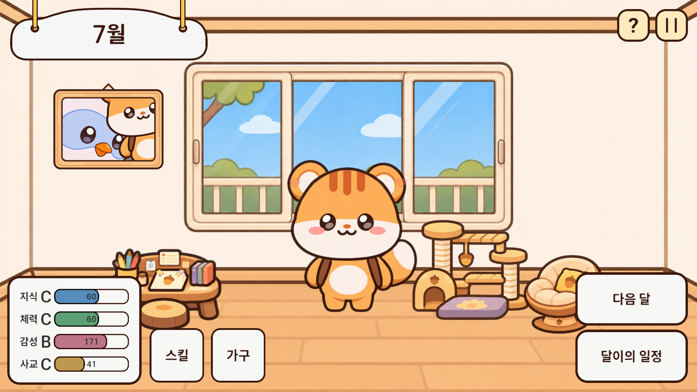
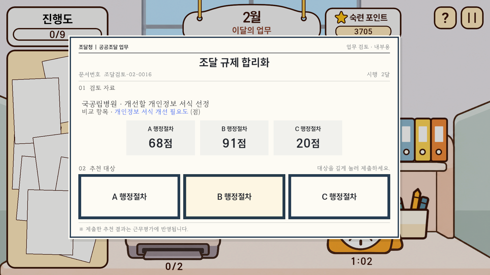
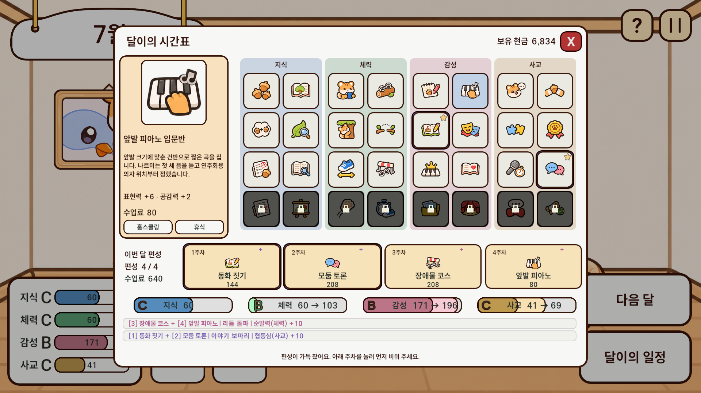
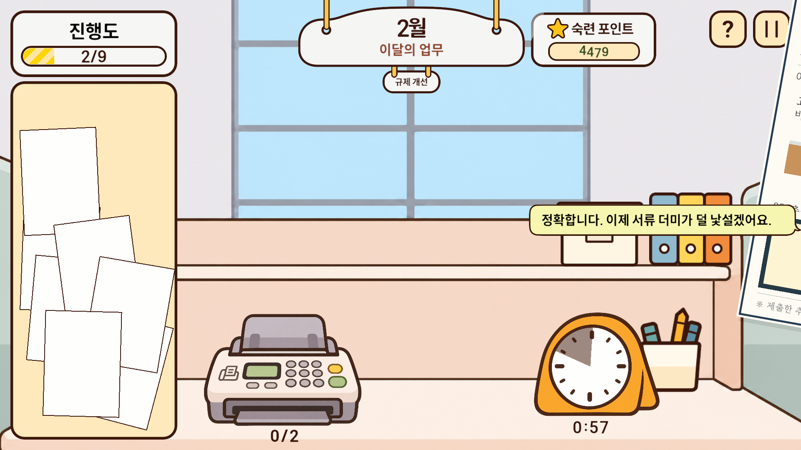
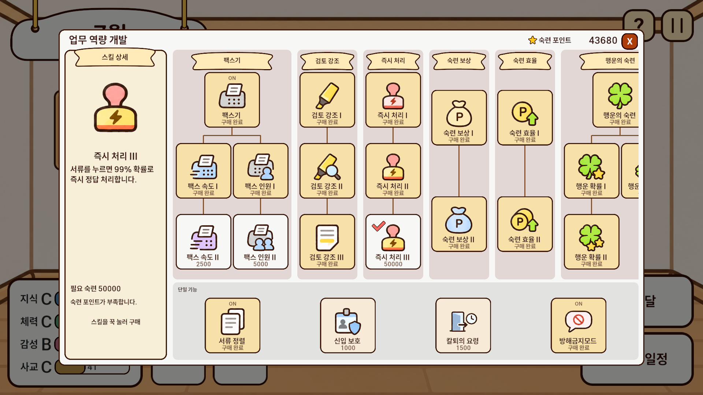
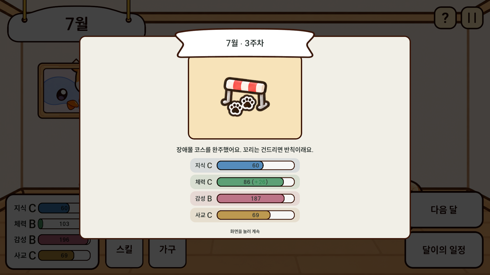

# 달이메이커

**회사에서는 서류를 처리하고, 집에서는 다람쥐 달이와 함께 성장하는 업무·육성 시뮬레이션 게임입니다.**

조달청에 취업한 나르미는 첫 출근을 앞두고 작은 다람쥐 달이를 만나 함께 살게 됩니다.
낮에는 책상 위에 쌓인 서류를 처리하고, 퇴근 후에는 달이의 수업을 정하고 이야기를 나눕니다.
1월부터 12월까지, 일과 달이 사이에서 어떤 한 해를 보낼지는 플레이어의 선택에 달려 있습니다.

## 게임 진행

### 출근해서 업무 처리하기

책상 위 서류를 열어 내용을 읽고, 숫자·그래프·별점·등급으로 제시된 정보를 비교해 알맞은 선택지를 고릅니다.
선택지를 누르고 있으면 서류가 제출됩니다.

업무를 모두 마치면 일찍 퇴근할 수 있고, 남은 서류를 처리하기 위해 초과근무를 할 수도 있습니다.
처리하지 못한 서류는 다음 달로 이월되며, 분기마다 업무 평가와 보너스를 받습니다.

### 퇴근 후 달이 돌보기

번 돈으로 달이의 수업과 선물을 준비합니다.
매달 네 칸의 시간표에 수업·홈스쿨링·휴식을 편성하고, 달이가 어떤 분야에 관심을 넓혀 갈지 정합니다.

- **지식**: 생각하고 탐구하는 힘
- **체력**: 몸을 움직이고 도전하는 힘
- **감성**: 상상하고 표현하는 힘
- **사교**: 다른 이들과 소통하고 어울리는 힘

수업 조합에 따라 시너지가 생기고, 선물한 가구는 달이의 방과 성장에 변화를 줍니다.

### 달이와 약속 지키기

달이는 함께 보내고 싶은 시간을 이야기하고 약속을 제안합니다.
퇴근 시간과 약속을 지켰는지에 따라 달이의 반응이 달라집니다.
성장 수치뿐 아니라, 대화와 함께 보낸 시간도 두 사람의 관계를 만들어 갑니다.

### 한 해의 끝에서

12월을 마치면 달이의 성장에 따라 여러 진로의 엔딩을 만나게 됩니다.
같은 진로라도 친밀도에 따라 후일담이 달라집니다.
만난 엔딩은 모음집에서 확인할 수 있습니다.

추가 플레이 화면 보기

**업무 책상**

**업무 역량 개발**

**수업 결과**

## 조작 방법

마우스를 중심으로 플레이합니다.

| 상황 | 조작 |
| --- | --- |
| 서류 열기 | 책상 위 서류 클릭 |
| 서류 제출 | 선택지를 누르고 있기 |
| 시간표 편성 | 수업을 클릭해 빈 칸에 추가 |
| 편성 취소 | 시간표에 넣은 주차 카드 클릭 |
| 대화 진행 | 클릭으로 문장 완성 또는 다음 대사 보기 |

